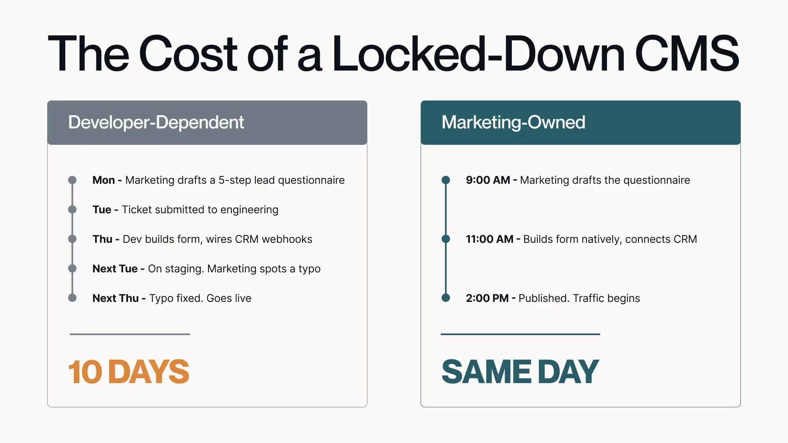
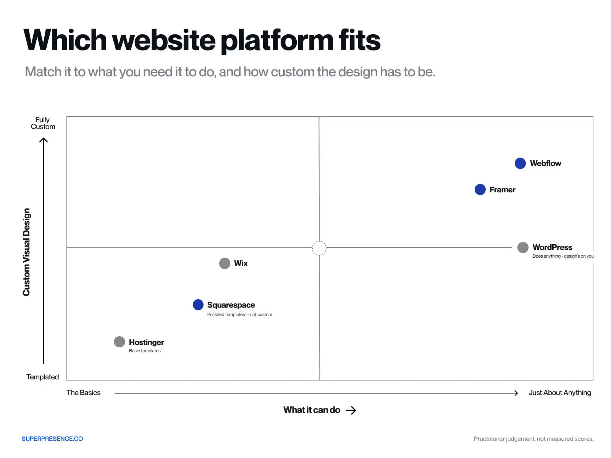
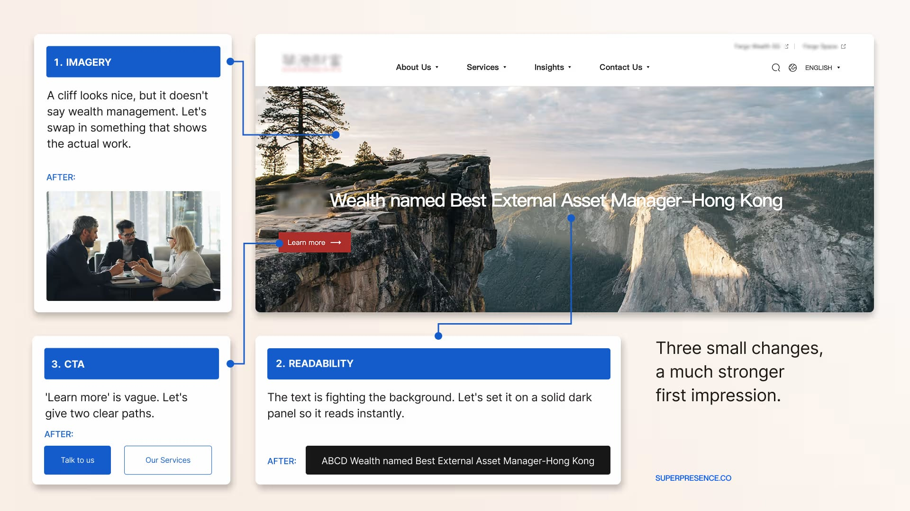

The right website builder for your business is the one your marketing team **can change without filing a developer ticket**, on a design that looks as serious as the buyers you're chasing.

Most guides start with your goals, list the features you need, then match those to a platform. That's a fine starting point, but it misses who will actually be **managing the site day-to-day**, and how credible it looks to the buyers you're trying to win over.

One thing to know going into this article: Superpresence builds premium websites, but this article still points out **when a $100 template is the smarter buy**.

## What job is the site actually doing?

Before you pick a website builder, **name what the site is for**. A store that takes payments, a lead-gen site that has to rank and convert, and a simple site that just needs to exist are three different jobs. And the right platform differs for each, covered in the comparison later in this piece.

One job hides inside the lead-gen answer, and teams miss it constantly. A site that has to convert both paid and organic traffic needs more than good looks. It needs a **structure that search engines can crawl and read**: clear headings, real service pages, structured metadata.

A platform picked for its animations and full-screen video can launch looking impressive and still stay invisible in search.

## Who actually controls your site: marketing or a developer?

The single question that decides **more than any feature list**: can the person responsible for enquiries change the site this week, without waiting on someone else's sprint?

When they can't, **campaigns lag behind their own ad spend and experimentation stops**. Not because the team is slow, but because every change is somebody else's queue.

This shows up in two ways. IT or engineering locks down the CMS for security, so marketing has to file a ticket for every copy tweak, and campaign pages arrive weeks after the ads that needed them.

Or a tech founder hands the site to the product designer and development team, who build it in code. It looks great at launch, but every edit now routes through a product team focused on the roadmap, so the site stalls while the company keeps growing.

Here's the split that matters. Same-day, a marketing-owned platform lets the team:

- **Change a headline or rewrite a section** the moment the message shifts
- **Launch a campaign landing page** the same day an ad goes live
- **Run an A/B test or swap proof** without booking developer time

Under $100/month, **choose no-code options** over custom or complex platforms, since ease of use matters more than flexibility at this price point.

Full control has its own failure mode: without oversight, non-technical teams can end up with bloated, slow, inconsistent pages over time. Ownership works best with a light hand on the wheel.

Not sure whether your current site lets marketing move or makes them wait on a developer? [Request a website review](https://superpresence.co/website-review) and we'll walk it the way your own team has to, and show you exactly where changes get stuck.

## Which platform fits you

With the groundwork covered, the choice gets simple. Match the platform to the job first, then to who'll maintain it, then to how much polish your buyers expect. Most shortlists collapse to one or two real options.

Review sites tend to go easy on each platform's weaknesses. Treat the table below as a starting point for that, not the final word. Dig into it yourself before you decide.

**Webflow and Framer** sit at the top: fully custom design paired with the ability to build almost anything, the design freedom most [webflow development](https://superpresence.co/service/webflow-development) projects are built around. Both ask for real design and dev skill to get there.

**WordPress** reaches just as far on capability. It can do almost anything, but the design work is entirely on you or whoever you hire to build it.

**Wix and Squarespace** sit in the middle. Wix trades some design range for ease of use. Squarespace goes further on polish through its templates, but doesn't let you go fully custom.

**Hostinger** sits at the bottom: basic templates and the least design range, in exchange for the lowest price and least effort.

One thing to note is that **pricing changes fast**. Every price and plan tier above can shift without notice, and the number you see upfront often isn't the number you'll pay long-term. Check the current plan page, including renewal pricing, before you commit to a plan.

## Does the website builder allow you to look as credible as you are?

If you win business on trust and authority, the platform is a positioning decision. A serious buyer who lands on a familiar $100 generic template or AI-generated website with stock imagery reads it the way they'd read a business card printed on home paper.

There's no clean study putting a number on this. Nobody has measured the exact credibility discount a high-ticket buyer applies to a recognizable template.

An established firm with years of referral business and real authority in its field finally decides to get a website. It reaches for a low-cost template to get online fast.

Then an international prospect gets referred. They land on stock photos and a layout they've seen a hundred times, and the firm slides down the shortlist instead of filling out the contact form.

The comparison guides say the plain version of this: you get what you pay for, and cheap or free builders trade away design depth and functionality. For a firm charging premium fees on trust, that trade-off is the first thing a buyer sees.

### When a $100 template is the right answer

If you're still testing an idea with no revenue yet, buy the cheap template and get on with it. Speed matters more than polish while you're finding out whether anyone wants the thing.

That's not the same as being new. If you're early and trying to outcompete established players on the first impression, that's exactly when it's worth [talking to us](https://superpresence.co/contact).

## Will it still fit the business you're becoming?

Founders often pick the fast, cheap website builder to get live, plan to upgrade later, then postpone the move for years while the site drifts further behind the company's actual scale.

When the move finally happens, it's never just moving pages. It forces the questions you skipped the first time: **what do you sell now, to whom, and how do you prove it?**

A [webflow migration](https://superpresence.co/service/migrate-to-webflow), for instance, still has to preserve content and rankings while fixing the positioning gaps the first site never addressed.

Here’s another common scenario: a startup launches on a **simple template** to validate an idea, raises a round, and moves upmarket to enterprise buyers. The site still looks early, built for the first version of the company.

Sales starts hearing about it from prospects. The replatform gets flagged as urgent, then delayed again, because the team hands it to engineering as a technical fix. What actually needs fixing is the positioning.

That's the part most teams under-weigh at launch. Moving platforms exposes gaps the first site papered over: **the muddled positioning, the missing proof, the pages built for a buyer you've outgrown**. Treating it as a lift-and-shift means carrying those gaps onto the new platform.

## Final thoughts

So the honest answer depends on two things you already know. If you're still testing an idea with no revenue yet, take the cheap template and move on.

If you sell high-ticket work on trust, pick a platform your marketing team can run and that looks as serious as your buyers expect, even when it costs more.

The mistake isn't picking the wrong platform. It's who gets to decide, and why. Most teams are too close to their own site to see which one they're getting wrong.

If you're weighing a rebuild or a replatform, the useful first step is seeing what a cautious buyer sees today. [Get a free website review](https://superpresence.co/website-review) and Superpresence will show you what holds up on your current site and where it's costing you enquiries.

## Frequently asked questions

**Question about this topic here?** Subheading here as the answer from this topic - Lorem ipsum dolor sit amet

**Question about this topic here?** Subheading here as the answer from this topic - Lorem ipsum dolor sit amet

**Question about this topic here?** Subheading here as the answer from this topic - Lorem ipsum dolor sit amet

**Question about this topic here?** Subheading here as the answer from this topic - Lorem ipsum dolor sit amet

**Question about this topic here?** Subheading here as the answer from this topic - Lorem ipsum dolor sit amet
