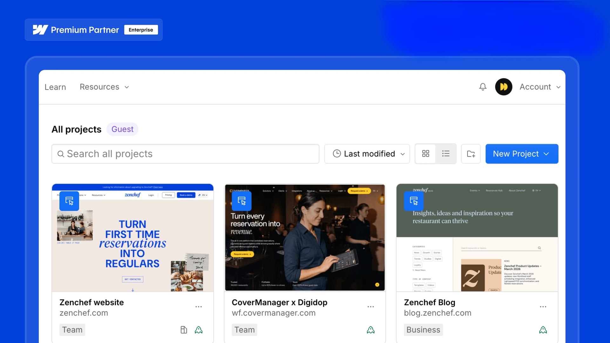
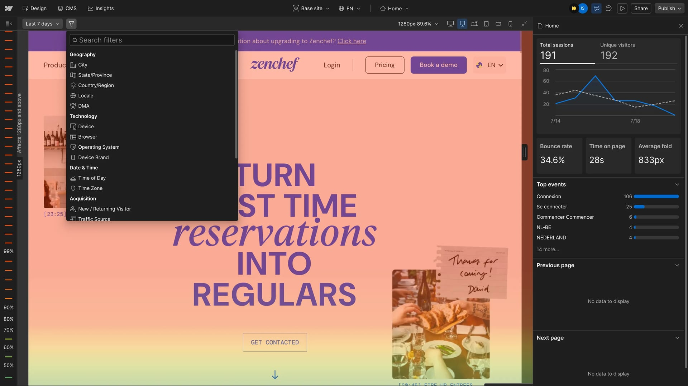
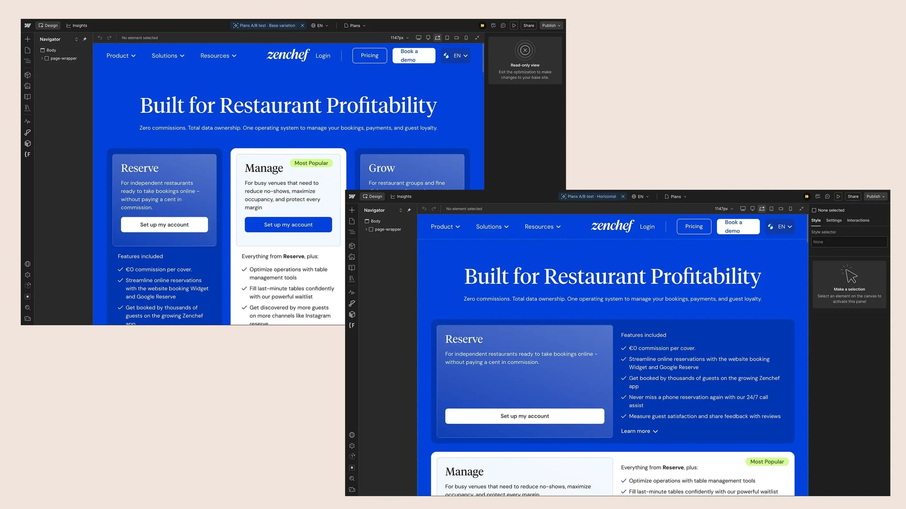
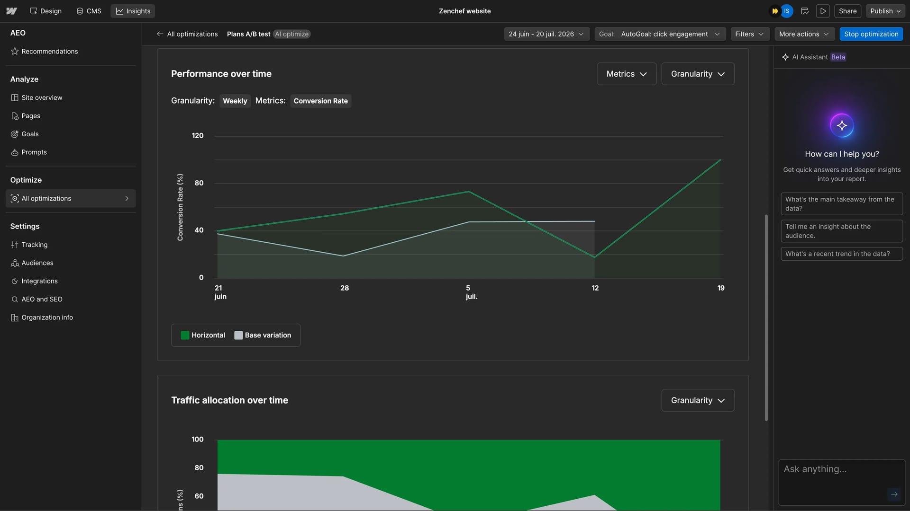
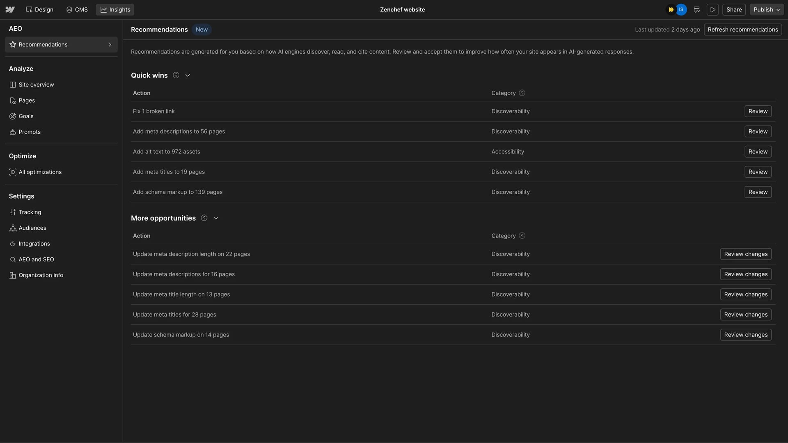

## Overview

Zenchef already had a strong digital foundation, but unlocking the full potential of Webflow Enterprise required more than simply activating new tools. The challenge was to connect the platform with the way its Marketing and Growth teams actually work—making data easier to understand, experiments easier to run, and optimization part of the everyday workflow.

Superpresence helped structure the rollout around three core needs: **better visibility, faster experimentation, and greater team autonomy**. We configured the platform around Zenchef's objectives, introduced the right tools, and supported the team through hands-on adoption.

The goal wasn't to build another website. It was to create a stronger foundation for a website that could **learn, improve, and grow continuously**.

## What wasn't working?

Zenchef needed to get more value from its existing digital ecosystem without creating additional complexity for its Marketing and Growth teams.

The main challenges were:

- **Enterprise deployment.** The Webflow Enterprise environment needed to be properly deployed and structured around Zenchef's operational needs.
- **Product configuration.** Enterprise capabilities needed to be configured around specific marketing, analytics, experimentation, and visibility goals.
- **Team adoption.** New tools only create value when the people using them understand how—and when—to use them.
- **Faster experimentation.** The team needed a simpler way to test ideas, understand user behavior, and make decisions based on actual data.
- **Continuous optimization.** The website needed to become an evolving growth channel rather than something that was only reviewed when a new project started.

## What could be better?

We saw an opportunity to simplify the relationship between **data, experimentation, and action**.

Instead of treating analytics, A/B testing, and SEO as separate activities, we structured them as one continuous loop: **Understand → Test → Learn → Improve**

That meant giving the team better visibility into how visitors behave, creating a faster path from insight to experiment, and turning SEO and AEO recommendations into actionable opportunities.

The bigger opportunity wasn't simply improving one page or one conversion rate. It was helping Zenchef build a repeatable optimization habit that could continue long after the initial rollout.

## How we approached the problem

Our approach focused on making the technology fit the business—not the other way around.

- **Understand.** We first looked at Zenchef's existing workflow, business objectives, and the role different teams played in managing and improving the website.
- **Configure.** We configured the platform around those priorities, making sure each product had a clear purpose within the team's workflow.
- **Enable.** We worked alongside the Website Manager through product demonstrations, training sessions, and hands-on guidance.
- **Experiment.** Once the foundations were in place, the team could begin testing different experiences and using real behavioral data to identify opportunities.
- **Improve.** The recommendations and insights generated through the platform became inputs for continuous optimization—creating a cycle that could continue beyond the initial engagement.

## What we built

Rather than building a new website, the work focused on putting the right Enterprise capabilities in place and making them useful to Zenchef's teams.

### Webflow Analyze

We introduced a clearer way to understand website performance, user journeys, and potential optimization opportunities. Instead of relying solely on disconnected analytics tools, the team could access meaningful behavioral insights within its Webflow environment.

**Purpose:** Understand what users are doing before deciding what to change.

### Webflow Optimize

We established the foundation for experimentation through A/B testing and audience personalization. This gave the team a practical way to validate ideas instead of relying purely on assumptions.

**Purpose:** Turn ideas into measurable experiments.

### Webflow AEO

We introduced SEO and AEO recommendations to help Zenchef improve its visibility across traditional search engines and emerging AI-powered answer engines.

**Purpose:** Turn search visibility into an ongoing optimization opportunity.

## Built to keep growing

A successful Enterprise implementation shouldn't leave the client dependent on an agency for every next step. That's why adoption was treated as part of the project—not something that happens after it.

We supported the Website Manager through:

- **Product demonstrations**
- **Hands-on training**
- **Real use cases**
- **Configuration support**
- **Experimentation guidance**
- **Ongoing optimization recommendations**

This created a more autonomous workflow where the Marketing and Growth teams could explore insights, launch experiments, and identify opportunities without waiting for another development cycle.

The original project reports that Zenchef's teams were already using the Enterprise suite independently only a few weeks after deployment.

> A system designed for the next experiment, not just the current launch.

That distinction matters.

A website can be launched once. A growth system needs to keep learning.

## What changed after launch

Only a few weeks after deployment, Zenchef's teams were already using the Enterprise capabilities independently. The first experiments began generating measurable improvements, while Analyze and AEO recommendations created a foundation for continued optimization.

- **+49% Conversion uplift on the first A/B test** 
  The first experiment demonstrated that optimization could create measurable impact without requiring a complete website redesign.
- **350+ SEO & AEO recommendations generated** 
  The recommendation engine created a broader backlog of opportunities for improving organic and AI-search visibility.
- **Greater team autonomy : Marketing and Growth teams became more independent** 
  Instead of relying on external support for every optimization cycle, the team gained the tools and knowledge needed to continue improving the platform themselves.

The mistake isn't picking the wrong platform. It's who gets to decide, and why. Most teams are too close to their own site to see which one they're getting wrong.

If you're weighing a rebuild or a replatform, the useful first step is seeing what a cautious buyer sees today. [Get a free website review](https://superpresence.co/website-review) and Superpresence will show you what holds up on your current site and where it's costing you enquiries.

## Frequently asked questions

- **Was this a website redesign?** No. The project focused primarily on deploying and adopting Webflow Enterprise rather than rebuilding Zenchef's website from scratch. The objective was to configure the Enterprise capabilities around Zenchef's needs and help the team use them effectively.
- **What Webflow Enterprise products were implemented?** The project introduced three core capabilities: Webflow Analyze, Webflow Optimize, and Webflow AEO. Together, they support behavioral analysis, experimentation, and search visibility optimization.
- **Why was team training part of the project?** Because technology only creates value when teams can confidently use it. Training and hands-on guidance helped Zenchef's Website Manager become more autonomous with the Enterprise suite.
- **How quickly did Zenchef see results?** The original case study reports that the team was independently using the Enterprise suite within a few weeks, with the first A/B test producing a 49% conversion uplift.
- **What does AEO mean?** AEO, or Answer Engine Optimization, focuses on improving a brand's visibility in AI-powered answer experiences alongside traditional search engines. In this project, AEO recommendations were used as part of the ongoing visibility optimization process.
- **Does Superpresence only help with Webflow implementation?** No. For a Superpresence case-study framework, this project can be positioned around the broader capability of designing, building, and improving digital experiences—with Webflow acting as the platform rather than the story itself.
